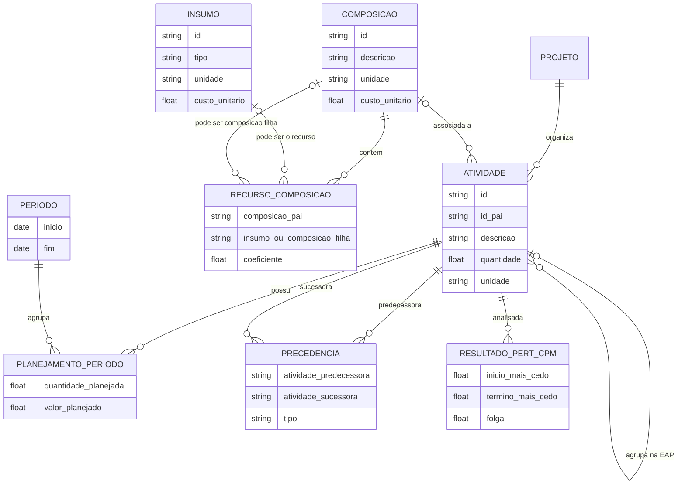
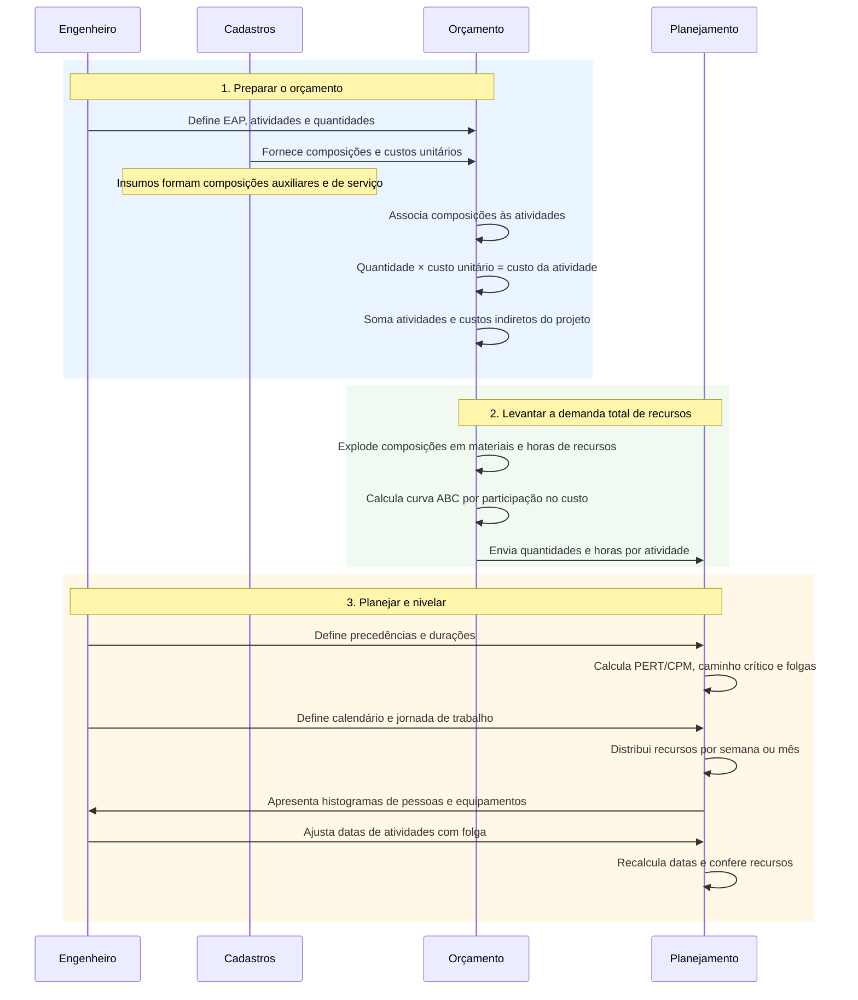
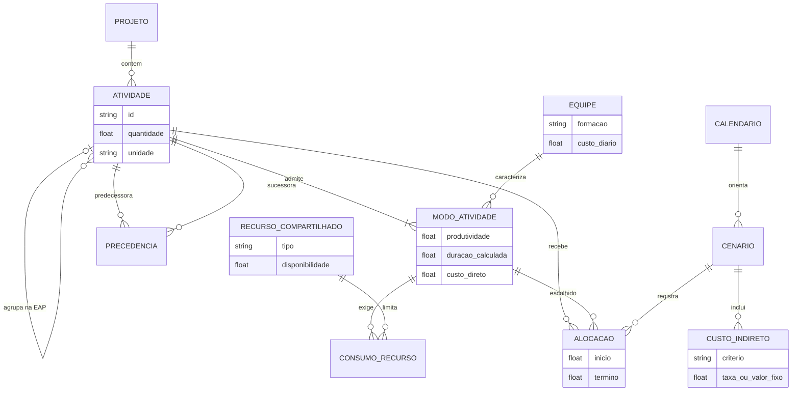
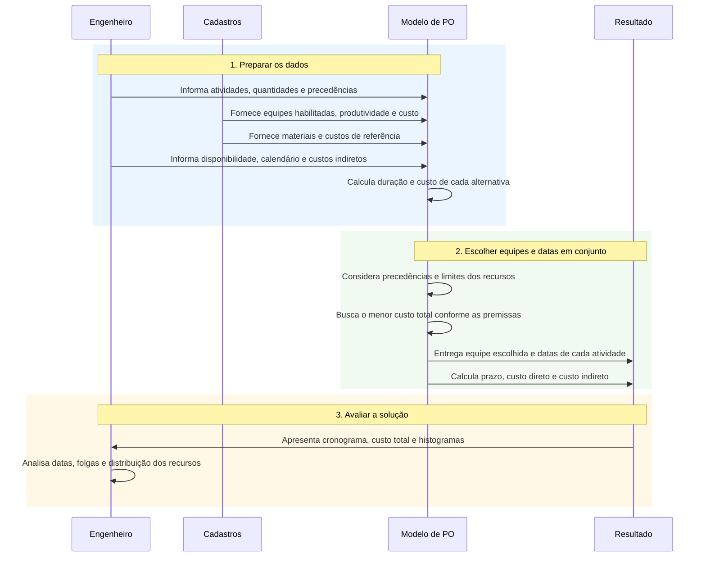

# Pesquisa operacional aplicada ao planejamento de obras

Projeto acadêmico de Pesquisa Operacional aplicada ao planejamento de obras. A minimização de custo será realizada sobre um caso simulado, com escolha de equipes e datas de início sujeita a recursos limitados. Os dados anonimizados contextualizam a organização do orçamento e o processo convencional de planejamento.

## A ideia em uma leitura

No orçamento convencional, as quantidades de serviços e as composições determinam o custo; o cronograma e a distribuição dos recursos são desenvolvidos a partir das durações e precedências. Neste trabalho, investigamos uma decisão integrada: **qual equipe habilitada executar em cada atividade e quando**, considerando que sua produtividade altera a duração e que o prazo afeta os custos indiretos do projeto.

Termos úteis: **EAP** é a decomposição hierárquica do trabalho; **composição de custo unitário (CPU)** reúne os recursos necessários por unidade de serviço; **PERT/CPM** analisa a rede de precedências, datas e folgas; e **PO** é pesquisa operacional. Uma relação pai–filho na EAP não é, por si só, uma precedência entre atividades.

## Escopo do trabalho e bases utilizadas

O trabalho consiste no **desenvolvimento e na avaliação de um modelo de PO em um caso simulado de construção, contextualizado pelo processo de orçamento e planejamento observado no projeto anonimizado**.

A pergunta de pesquisa é: **como a escolha conjunta de equipes e datas de início influencia o custo total e o prazo de uma obra, respeitando precedências e disponibilidade de recursos?** O modelo é uma variante determinística do MRCPSP, problema de programação de projetos com recursos limitados e modos alternativos de execução. A contribuição acadêmica está na aplicação, formulação e avaliação do modelo e na interpretação dos resultados. O vínculo com a literatura está descrito nas [referências de modelagem](outputs/otimizacao_piloto/referencias_modelagem.md).

### Qual base será usada na minimização?

| Base ou pasta | Papel no trabalho |
|---|---|
| `dados_anonimizados/` | Referência para explicar EAP, composições, insumos e planejamento na abordagem convencional |
| `dados_simulados/eap_academica_sintetica_escala_exemplo/` | EAP acadêmica independente usada como referência estrutural e de pontos de custo para o recorte simulado |
| `outputs/otimizacao_piloto/dados_modelo/` | Entradas efetivamente lidas pelos solvers: atividades, alternativas, precedências, recursos e premissas de custo |
| `outputs/otimizacao_piloto/dados_modelo_ampliado/` | Recorte ampliado: 68 tarefas individuais, rede lógica, modos e cenário de referência factível |
| `outputs/otimizacao_piloto/resultados_gurobi/` | Cronograma e resumo produzidos pelo solver Gurobi |

Portanto, **a aplicação quantitativa será feita nos dados simulados**, preparados para o problema de otimização. O gerador do piloto utiliza a EAP acadêmica independente e acrescenta quantidades, produtividades, alternativas de equipe e precedências hipotéticas. Os vínculos de origem registrados nesses CSVs apontam para a EAP acadêmica. Eles não estabelecem uma correspondência validada com as atividades do projeto anonimizado.

### Recorte ampliado com tarefas paralelas

O [recorte ampliado](outputs/otimizacao_piloto/LEIA-ME-AMPLIADO.md) contém 68 tarefas, um marco inicial, 92 precedências e 204 alternativas de equipe. Cada tarefa corresponde a uma folha distinta da EAP sintética, e o PERT/CPM é calculado sobre essas tarefas, não sobre seus agrupadores. Foram modelados quatro setores e atividades paralelas dentro de cada setor. As precedências são hipóteses do caso acadêmico, não foram extraídas do projeto anonimizado. O CPM lógico resulta em 29,19 dias úteis; com os recursos limitados e as equipes padrão, a referência factível dura 72,40 dias. Os resultados abaixo se referem exclusivamente ao piloto anterior de 12 atividades.

<!-- INICIO GANTT AMPLIADO -->
### Gantt do recorte ampliado por EAP

A visualização usa a solução factível do Gurobi registrada em `resultados_ampliado/`: 68 tarefas, prazo de 50,16 dias úteis e gap de 7,57%, sem otimalidade comprovada. As linhas estão agrupadas pela hierarquia original da EAP (fase → conta de controle → pacote → tarefa); os agrupadores não são atividades nem criam precedências. O marco inicial ocorre no dia 0.

O Mermaid exige uma escala de datas: **01/01/2026 representa o dia útil 0**, e cada dia no eixo equivale a um dia útil do modelo. As datas são apenas uma régua fictícia, sem calendário civil, fins de semana ou feriados. Os horários são convertidos e arredondados ao minuto para a visualização; os valores originais estão no CSV. Tarefas em linhas diferentes podem ocorrer em paralelo, respeitando os recursos da solução. Cada seção identifica fase e conta; o código antes de cada tarefa identifica também seu pacote de trabalho.

Em cada linha, **P** indica predecessoras e **S** sucessoras pelos IDs das tarefas; `-` indica ausência. `OP00` é o marco inicial. As relações são término-início, sem defasagem. Conforme a [sintaxe do Mermaid](https://mermaid.ai/open-source/syntax/gantt.html), `after` posiciona a tarefa no término mais tardio das predecessoras, enquanto a solução com recursos pode iniciá-la mais tarde. Por isso, as barras usam datas explícitas do solver e os vínculos aparecem nos rótulos; o Gantt não desenha setas entre elas.

```mermaid
gantt
    title Cronograma ampliado por tarefa e EAP — escala fictícia
    dateFormat YYYY-MM-DD HH:mm
    axisFormat %d/%m
    todayMarker off
    section Marcos
    OP00 Marco inicial :milestone, OP00, 2026-01-01 00:00, 0d
    section 1 Preparação, mobilização e engenharia / 1.1 Apoio e mobilização — frente 01
    1.1.1.3 OP001 Liberar utilidades provisórias [P OP00 | S OP002+OP006] :OP001, 2026-01-01 00:00, 2026-01-02 10:43
    1.1.3.1 OP002 Implantar pontos de controle [P OP001 | S OP003+OP004] :OP002, 2026-01-02 10:43, 2026-01-03 21:26
    1.1.5.1 OP003 Preparar documentação de liberação [P OP002 | S OP006] :OP003, 2026-01-03 21:26, 2026-01-05 08:10
    1.1.7.1 OP004 Detalhar solução executiva [P OP002 | S OP005] :OP004, 2026-01-16 03:12, 2026-01-19 07:17
    1.1.10.1 OP005 Confirmar especificação de fornecimento [P OP004 | S OP011+OP014] :OP005, 2026-01-19 07:17, 2026-01-23 11:22
    section 1 Preparação, mobilização e engenharia / 1.2 Levantamentos — frente 02
    1.2.1.1 OP018 Montar módulo temporário [P OP00 | S OP019+OP023] :OP018, 2026-01-06 18:53, 2026-01-08 22:58
    1.2.3.1 OP019 Levantar faixa de implantação [P OP018 | S OP020+OP021] :OP019, 2026-01-10 08:19, 2026-01-11 19:02
    1.2.5.1 OP020 Validar acesso à área [P OP019 | S OP023] :OP020, 2026-01-13 23:07, 2026-01-16 03:12
    1.2.6.1 OP021 Compatibilizar interfaces [P OP019 | S OP022] :OP021, 2026-01-24 15:26, 2026-01-27 19:31
    1.2.9.1 OP022 Emitir pedido de material [P OP021 | S OP028+OP031] :OP022, 2026-01-27 19:31, 2026-01-30 14:14
    section 1 Preparação, mobilização e engenharia / 1.3 Engenharia e liberações — frente 03
    1.3.1.1 OP035 Liberar utilidades provisórias [P OP00 | S OP036+OP040] :OP035, 2026-01-02 10:43, 2026-01-04 14:48
    1.3.3.1 OP036 Levantar faixa de implantação [P OP035 | S OP037+OP038] :OP036, 2026-01-05 08:10, 2026-01-06 18:53
    1.3.5.1 OP037 Registrar condicionantes de execução [P OP036 | S OP040] :OP037, 2026-01-08 21:36, 2026-01-10 08:19
    1.3.6.1 OP038 Revisar sequência construtiva [P OP036 | S OP039] :OP038, 2026-01-06 18:53, 2026-01-08 21:36
    1.3.9.1 OP039 Inspecionar recebimento [P OP038 | S OP045+OP048] :OP039, 2026-01-09 13:36, 2026-01-12 08:19
    section 1 Preparação, mobilização e engenharia / 1.4 Suprimentos — frente 04
    1.4.1.1 OP052 Organizar acesso da frente [P OP00 | S OP053+OP057] :OP052, 2026-01-04 14:48, 2026-01-06 18:53
    1.4.3.1 OP053 Levantar faixa de implantação [P OP052 | S OP054+OP055] :OP053, 2026-01-11 19:02, 2026-01-13 23:07
    1.4.4.1 OP054 Registrar condicionantes de execução [P OP053 | S OP057] :OP054, 2026-01-22 11:22, 2026-01-24 15:26
    1.4.5.1 OP055 Emitir desenho para campo [P OP053 | S OP056] :OP055, 2026-01-19 07:17, 2026-01-22 11:22
    1.4.8.1 OP056 Liberar lote para uso [P OP055 | S OP062+OP065] :OP056, 2026-01-23 11:22, 2026-01-27 15:26
    section 2 Preparação física, terraplenagem e drenagem / 2.1 Acessos e limpeza — frente 01
    2.1.1.1 OP006 Limpar área de trabalho [P OP001+OP003 | S OP007+OP008+OP011] :OP006, 2026-01-05 08:10, 2026-01-07 08:10
    2.1.6.1 OP007 Escavar travessia [P OP006 | S OP010] :OP007, 2026-01-07 08:10, 2026-01-09 12:14
    2.1.12.1 OP008 Executar corte de material [P OP006 | S OP009+OP010] :OP008, 2026-01-07 08:10, 2026-01-09 12:14
    2.1.25.1 OP009 Regularizar superfície [P OP008 | S OP013] :OP009, 2026-02-04 19:31, 2026-02-06 19:31
    2.1.30.1 OP010 Escavar vala longitudinal [P OP007+OP008 | S OP013] :OP010, 2026-01-10 04:14, 2026-01-12 08:19
    2.1.36.1 OP011 Preparar base de fundação [P OP005+OP006 | S OP012] :OP011, 2026-01-24 22:05, 2026-01-27 00:48
    section 2 Preparação física, terraplenagem e drenagem / 2.2 Movimentação de terra — frente 02
    2.2.1.1 OP023 Preparar acesso temporário [P OP018+OP020 | S OP024+OP025+OP028] :OP023, 2026-01-16 04:24, 2026-01-18 04:24
    2.2.6.1 OP024 Preparar berço de assentamento [P OP023 | S OP027] :OP024, 2026-01-18 04:24, 2026-01-19 15:07
    2.2.12.1 OP025 Carregar e transportar solo [P OP023 | S OP026+OP027] :OP025, 2026-01-18 04:24, 2026-01-20 08:29
    2.2.25.1 OP026 Ajustar umidade [P OP025 | S OP030] :OP026, 2026-01-22 19:22, 2026-01-24 19:22
    2.2.30.1 OP027 Instalar elemento drenante [P OP024+OP025 | S OP030] :OP027, 2026-01-22 00:38, 2026-01-23 11:22
    2.2.36.1 OP028 Montar armadura [P OP022+OP023 | S OP029] :OP028, 2026-01-30 14:14, 2026-02-01 16:58
    section 2 Preparação física, terraplenagem e drenagem / 2.3 Subleito — frente 03
    2.3.1.1 OP040 Organizar área de estocagem [P OP035+OP037 | S OP041+OP042+OP045] :OP040, 2026-01-10 08:19, 2026-01-12 08:19
    2.3.6.1 OP041 Assentar tubo transversal [P OP040 | S OP044] :OP041, 2026-01-19 20:34, 2026-01-22 00:38
    2.3.12.1 OP042 Distribuir material de aterro [P OP040 | S OP043+OP044] :OP042, 2026-01-13 19:02, 2026-01-15 23:07
    2.3.25.1 OP043 Compactar camada [P OP042 | S OP047] :OP043, 2026-01-20 08:29, 2026-01-22 08:29
    2.3.30.1 OP044 Executar enchimento filtrante [P OP041+OP042 | S OP047] :OP044, 2026-01-23 11:22, 2026-01-24 22:05
    2.3.36.1 OP045 Executar concretagem [P OP039+OP040 | S OP046] :OP045, 2026-01-12 08:19, 2026-01-15 12:24
    section 2 Preparação física, terraplenagem e drenagem / 2.4 Dispositivos de drenagem — frente 04
    2.4.1.1 OP057 Remover material superficial [P OP052+OP054 | S OP058+OP059+OP062] :OP057, 2026-01-24 19:22, 2026-01-26 19:22
    2.4.6.1 OP058 Executar proteção de saída [P OP057 | S OP061] :OP058, 2026-01-27 00:48, 2026-01-28 11:31
    2.4.12.1 OP059 Conformar plataforma [P OP057 | S OP060+OP061] :OP059, 2026-02-01 14:44, 2026-02-03 18:49
    2.4.25.1 OP060 Verificar condição do subleito [P OP059 | S OP064] :OP060, 2026-02-09 21:02, 2026-02-11 21:02
    2.4.30.1 OP061 Conectar saída de drenagem [P OP058+OP059 | S OP064] :OP061, 2026-02-07 00:58, 2026-02-09 05:02
    2.4.36.1 OP062 Conferir elemento de contenção [P OP056+OP057 | S OP063] :OP062, 2026-01-28 11:31, 2026-01-30 14:14
    section 3 Estruturas, bases e revestimentos / 3.1 Estruturas — frente 01
    3.1.1.1 OP012 Montar elemento estrutural [P OP011 | S OP013] :OP012, 2026-02-04 08:58, 2026-02-07 00:58
    3.1.8.1 OP013 Produzir mistura de base [P OP009+OP010+OP012 | S OP014] :OP013, 2026-02-07 00:58, 2026-02-09 05:02
    3.1.16.1 OP014 Produzir mistura asfáltica [P OP005+OP013 | S OP015] :OP014, 2026-02-09 05:02, 2026-02-11 05:02
    section 3 Estruturas, bases e revestimentos / 3.2 Camadas granulares — frente 02
    3.2.1.1 OP029 Instalar armadura ou ligação [P OP028 | S OP030] :OP029, 2026-02-01 16:58, 2026-02-04 08:58
    3.2.8.1 OP030 Transportar material granular [P OP026+OP027+OP029 | S OP031] :OP030, 2026-02-04 08:58, 2026-02-06 13:02
    3.2.15.1 OP031 Transportar mistura [P OP022+OP030 | S OP032] :OP031, 2026-02-06 13:02, 2026-02-08 13:02
    section 3 Estruturas, bases e revestimentos / 3.3 Revestimento — frente 03
    3.3.1.1 OP046 Concretar ou fixar estrutura [P OP045 | S OP047] :OP046, 2026-01-15 12:24, 2026-01-18 04:24
    3.3.8.1 OP047 Espalhar camada [P OP043+OP044+OP046 | S OP048] :OP047, 2026-01-29 11:22, 2026-01-31 15:26
    3.3.15.1 OP048 Aplicar camada de revestimento [P OP039+OP047 | S OP049] :OP048, 2026-01-31 15:26, 2026-02-02 15:26
    section 3 Estruturas, bases e revestimentos / 3.4 Interfaces construtivas — frente 04
    3.4.1.1 OP063 Inspecionar geometria do elemento [P OP062 | S OP064] :OP063, 2026-02-09 05:02, 2026-02-11 21:02
    3.4.7.1 OP064 Compactar camada granular [P OP060+OP061+OP063 | S OP065] :OP064, 2026-02-11 21:02, 2026-02-13 07:46
    3.4.14.1 OP065 Compactar superfície [P OP056+OP064 | S OP066] :OP065, 2026-02-13 09:07, 2026-02-15 09:07
    section 4 Segurança, inspeção e acabamento / 4.1 Defensas e sinalização — frente 01
    4.1.1.1 OP015 Instalar defensa [P OP014 | S OP016] :OP015, 2026-02-11 05:02, 2026-02-13 09:07
    4.1.6.1 OP016 Inspecionar serviço concluído [P OP015 | S OP017] :OP016, 2026-02-14 14:24, 2026-02-16 14:24
    section 4 Segurança, inspeção e acabamento / 4.2 Inspeções — frente 02
    4.2.1.1 OP032 Implantar sinalização vertical [P OP031 | S OP033] :OP032, 2026-02-08 19:31, 2026-02-10 23:36
    4.2.6.1 OP033 Executar ensaio de recebimento [P OP032 | S OP034] :OP033, 2026-02-11 03:41, 2026-02-13 03:41
    section 4 Segurança, inspeção e acabamento / 4.3 Correções — frente 03
    4.3.1.1 OP049 Executar marcação horizontal [P OP048 | S OP050] :OP049, 2026-02-02 15:26, 2026-02-04 19:31
    4.3.6.1 OP050 Registrar pendência [P OP049 | S OP051] :OP050, 2026-02-04 19:31, 2026-02-06 19:31
    section 4 Segurança, inspeção e acabamento / 4.4 Acabamentos — frente 04
    4.4.1.1 OP066 Concluir arremate do trecho [P OP065 | S OP067] :OP066, 2026-02-15 09:07, 2026-02-16 19:50
    4.4.6.1 OP067 Verificar correção executada [P OP066 | S OP068] :OP067, 2026-02-16 19:50, 2026-02-18 19:50
    section 5 Entrega e encerramento / 5.1 Entrega — frente 01
    5.1.1.1 OP017 Preparar documentação final [P OP016 | S -] :OP017, 2026-02-16 19:50, 2026-02-18 19:50
    section 5 Entrega e encerramento / 5.2 Documentação — frente 02
    5.2.1.1 OP034 Entregar área ao operador [P OP033 | S -] :OP034, 2026-02-13 09:07, 2026-02-15 09:07
    section 5 Entrega e encerramento / 5.3 Desmobilização — frente 03
    5.3.1.1 OP051 Retirar instalação provisória [P OP050 | S -] :OP051, 2026-02-06 19:31, 2026-02-08 19:31
    section 5 Entrega e encerramento / 5.4 Encerramento administrativo — frente 04
    5.4.1.1 OP068 Encerrar registro da frente [P OP067 | S -] :OP068, 2026-02-18 19:50, 2026-02-20 03:50
```



O Gantt é atualizado automaticamente após uma solução válida do recorte ampliado gravada em `resultados_ampliado/`. Para atualizá-lo manualmente, execute `python scripts/atualizar_gantt_readme.py`. Os horários originais estão em [cronograma_gurobi.csv](outputs/otimizacao_piloto/resultados_ampliado/cronograma_gurobi.csv).
<!-- FIM GANTT AMPLIADO -->

### Os dados já permitem executar o modelo?

Sim. O piloto já dispõe de 12 atividades de execução, um marco, 13 precedências, 36 alternativas de equipe e seis famílias de recursos com capacidade unitária. As verificações registram rede sem ciclos, durações coerentes com quantidade/produtividade, conciliação dos custos diretos padrão com a EAP acadêmica e ausência de conflitos na referência factível. O script de minimização já está implementado e há resultados salvos.

Essas verificações demonstram a consistência interna do caso simulado. A produtividade, os custos e a disponibilidade usados na otimização são premissas acadêmicas. Sua aplicação a uma obra específica exigiria levantamento e validação próprios.

### Como comparar as metodologias?

O paralelo com o projeto anonimizado será **metodológico**: explicar como o orçamento convencional organiza atividades e composições e como a proposta incorpora alternativas de equipe à decisão de programação.

A comparação **quantitativa** será feita entre dois cenários do mesmo caso simulado:

| Cenário | Equipes e programação |
|---|---|
| Referência factível | Fixa as equipes padrão e usa uma heurística serial para programar as atividades, respeitando precedências e recursos |
| Otimizado | Escolhe equipes e datas de início conjuntamente para minimizar o custo total, respeitando as mesmas condições de execução |

Os dois cenários compartilham escopo, quantidades, precedências, calendário de referência, disponibilidade de recursos, catálogo de alternativas e critérios de custo. Na referência, a escolha é fixada no modo padrão; no otimizado, o modelo pode selecionar os demais modos habilitados. A referência é uma representação acadêmica de escolhas fixadas, não uma reprodução comprovada do cronograma do projeto anonimizado.

O PERT/CPM sem restrição de recursos é usado para analisar a rede lógica. A comparação principal de desempenho utiliza a referência factível, pois o CPM pode permitir sobreposição de atividades que disputam o mesmo recurso.

Nos [resultados salvos do piloto](outputs/otimizacao_piloto/dados_modelo/comparacao_cenarios.csv):

| Indicador | Referência factível | Otimizado | Redução em relação à referência |
|---|---:|---:|---:|
| Prazo em dias úteis | 34,00 | 24,33 | 28,4% |
| Custo total em pontos de índice | 24,9600 | 23,9759 | 3,9% |

Esses ganhos se referem ao caso simulado e à referência específica adotada. Não representam uma estimativa de economia no projeto anonimizado nem demonstram superioridade geral sobre o planejamento convencional. Ao alterar dados ou taxas, é necessário resolver novamente e atualizar os resultados e as verificações.

Uma aplicação futura aos dados anonimizados exigiria selecionar um recorte da mesma versão do projeto, mapear suas atividades, validar quantidades e precedências, levantar alternativas de equipe e conciliar os custos diretos e de apoio. A documentação registra ausência de predecessoras explícitas e pendências em fórmulas de parte da extração; essas questões precisam ser resolvidas para uma comparação econômica com a obra.

### Tipos de variáveis e atendimento ao requisito da disciplina

O modelo reúne pelo menos dois tipos de variáveis de decisão:

| Tipo | Variáveis | Exemplo |
|---|---|---|
| Booleana/binária | Escolha da equipe e ordem entre atividades que disputam um recurso | Escolher uma alternativa: 0 ou 1 |
| Contínua | Início das atividades e término do projeto | Início no dia útil 2,5 |

Essa combinação caracteriza uma programação linear inteira mista e atende ao requisito de usar pelo menos dois tipos. A variável binária é um caso particular de variável inteira discreta. O modelo atual não possui uma decisão inteira geral, como contratar 0, 1, 2 ou 3 equipes. A quantidade de pessoas de cada formação é um parâmetro cadastrado; a decisão consiste em escolher a formação. Se forem exigidos os três tipos separadamente, será necessário acrescentar uma decisão inteira geral com custos e restrições correspondentes.

## Como as informações do orçamento se relacionam

O diagrama representa o significado das entidades da base, não um esquema físico completo. Um recurso de composição é a linha que liga uma composição a um insumo **ou** a uma composição filha. A mesma composição pode ser usada em várias atividades ou composições.



Na extração descrita em [RULES.md](RULES.md), `MTAREFA` contém as atividades; `MCMP`, as composições; `MRECCMP`, suas linhas de recurso; e `MISM`, os insumos. `MTRFPLAN`/`MTRFPDO` e `MPERIODO` relacionam atividades e períodos. A extração não traz predecessoras explícitas: `PRECEDENCIA` e `RESULTADO_PERT_CPM` representam informações a levantar ou calcular, não tabelas confirmadas dessa extração.

## Fluxo convencional de orçamento e planejamento

Leia o diagrama **de cima para baixo**. Cada coluna representa uma parte do processo; as setas mostram as informações que passam entre elas. Os blocos numerados indicam a ordem principal de trabalho.



A explosão fornece as quantidades e horas totais; a curva ABC classifica os insumos por participação no custo. A sequência e as durações são definidas com apoio da experiência, de projetos anteriores e da bibliografia. A EAP organiza o escopo e não define, por si só, a sequência. O dimensionamento depende da jornada e utilização; ao deslocar atividades, é necessário conferir novamente as precedências e folgas.

Conforme o critério da empresa, alimentação e EPI podem compor os custos horários dos recursos diretos. Administração, mobilização e desmobilização são exemplos de custos que podem ser tratados separadamente como indiretos do projeto, sem dupla contagem.

## Proposta do trabalho: equipes, prazo e custo integrados

Cada atividade de serviço tem uma quantidade e alternativas de equipe habilitadas. Cada alternativa, ou **modo**, associa produtividade, formação, consumo de recursos e custo. A duração é obtida por `quantidade / produtividade`, com unidades compatíveis; por exemplo, 100 m³ a 20 m³/dia resultam em 5 dias úteis. O custo direto pode combinar custo diário de equipe e equipamento durante a execução com materiais e outros custos diretos pertinentes.

Nesta proposta, os custos de apoio antes incorporados ao custo horário do direto são tratados como indiretos, de acordo com as premissas escolhidas, sem duplicação. Custos indiretos dependentes do prazo aumentam ou diminuem com a duração do projeto; mobilização ou outros itens fixos entram uma única vez. A classificação de cada item deve ser documentada.

### Entidades propostas



`MODO_ATIVIDADE` representa a combinação habilitada de atividade e equipe: a produtividade e o custo podem depender da atividade. `ALOCACAO` registra a escolha em um cenário; conceitualmente, cada atividade executável recebe um modo por cenário. O catálogo de insumos e CPUs continua útil para fundamentar materiais e custos das alternativas, desde que as parcelas usadas no modelo sejam conciliadas.

### Fluxo de decisão

O diagrama segue a mesma leitura, de cima para baixo. O engenheiro prepara os dados; o modelo compara as alternativas e entrega uma solução para análise.



Ao mudar a equipe, mudam produtividade, duração e custo direto. A duração influencia o cronograma e o prazo do projeto; o prazo, por sua vez, influencia os custos indiretos dependentes do tempo. O custo total reúne custos diretos, indiretos e itens fixos, cada parcela contabilizada uma vez.

O modelo considera precedências e disponibilidade de recursos ao escolher equipes e inícios. O caminho crítico lógico deve ser interpretado junto às restrições de recursos; o PERT/CPM isolado não garante um cronograma executável. Histogramas ajudam a avaliar a distribuição das equipes, mas limitar recursos não significa necessariamente minimizar oscilações: para isso seria preciso um objetivo ou restrições adicionais.

**Situação do piloto:** a implementação atual já otimiza modos e inícios e inclui um indireto por dia de projeto, mobilização fixa e uma parcela de apoio por pessoa-dia. As parcelas de apoio ficam separadas dos salários e equipamentos do custo direto; sua classificação e seus valores precisam ser conciliados ao aplicar o modelo a uma obra. O piloto usa dados sintéticos, duração determinística e pools unitários; não otimiza explicitamente o nivelamento de histogramas nem usa calendários civis. Veja o [modelo matemático](outputs/otimizacao_piloto/modelo_matematico.md) e o [guia do piloto](outputs/otimizacao_piloto/LEIA-ME.md).

As sugestões bibliográficas fornecidas para fundamentar o trabalho estão em [referências bibliográficas](referencias/referencias_fornecidas.txt). O arquivo preserva as indicações e ressalvas recebidas; ele não contém os artigos e os dados bibliográficos precisam ser conferidos antes de sua citação.

## Modelo de minimização de custo: equações e implementação Python

Esta seção relaciona cada regra matemática ao código utilizado na análise. Os trechos em Python/Gurobi pertencem à função `solve()` de [resolver_gurobi.py](outputs/otimizacao_piloto/resolver_gurobi.py) e compartilham as variáveis preparadas nessa função. Para executar o modelo completo, use os comandos ao final da seção.

### Notação e dados de entrada

| Símbolo | Significado | Nome ou origem no Python |
|---|---|---|
| $A$ | Atividades de execução | `executable`, de `atividades.csv` |
| $E_i$ | Alternativas de equipe habilitadas para a atividade $i$ | `by_activity[i]`, de `habilitacoes_alternativas.csv` |
| $P$ | Pares predecessora–sucessora | `edges`, de `precedencias.csv` |
| $g(e)$ | Família de recurso compartilhado da alternativa $e$ | `pool[e]`, de `equipes.csv` |
| $Q_i$, $p_{i,e}$ | Quantidade do serviço e produtividade da alternativa | `QUANTIDADE`, `PRODUTIVIDADE_UNID_DIA` |
| $d_{i,e}$, $c_{i,e}$, $h_{i,e}$ | Duração, custo direto e efetivo de cada alternativa | `DURACAO_DIAS`, `CUSTO_DIRETO_TOTAL_INDICE`, `PESSOAS_EQUIPE` |
| $x_{i,e}$ | Variável binária de escolha da alternativa | `x[i, e]` |
| $S_i$, $D_i$ | Início e duração selecionada da atividade | `start[i]`, `duration[i]` |
| $T$ | Término do projeto contado a partir do dia zero | `end` |
| $C_f$, $c_t$, $c_h$ | Custo fixo, taxa indireta por dia útil e taxa de apoio por pessoa-dia | `cf`, `ct`, `ch`, de `custos_fixos.csv` e `premissas.csv` |
| $M$ | Horizonte usado para limitar as variáveis e desativar restrições condicionais | `horizon` |

Cada alternativa é uma formação possível de equipe, com mão de obra e equipamentos. Os perfis de uma mesma família compartilham a disponibilidade física dessa família. O marco `OP00` tem início e duração zero e não recebe equipe. Todos os custos atuais são pontos de índice sintéticos, sem moeda.

### Preparação: duração e custo de cada alternativa

Antes de resolver o modelo, calcula-se:

$$
d_{i,e}=\frac{Q_i}{p_{i,e}},\qquad p_{i,e}>0
$$

$$
c_{i,e}=k_{i,e}\,d_{i,e}+m_{i,e}
$$

Aqui, $k_{i,e}$ é o custo diário da equipe e equipamentos e $m_{i,e}$, o custo total dos materiais. Esses valores são parâmetros previamente calculados. O solver lê os valores do CSV; ele não estima produtividade.

**Script:** [gerar_base_otimizacao_piloto.py](outputs/otimizacao_piloto/gerar_base_otimizacao_piloto.py), no bloco que gera `habilitacoes_alternativas.csv`:

```python
productivity = task["std_productivity"] * profile["productivity_factor"]
duration = task["quantity"] / productivity
crew_day_cost = crew_equipment_day_std * profile["daily_cost_factor"]
crew_equipment_cost = crew_day_cost * duration
direct_cost = material_total + crew_equipment_cost
```

As produtividades e os multiplicadores do gerador são hipóteses acadêmicas. As durações são contínuas, sem arredondamento para dias inteiros.

### R1. Uma alternativa habilitada por atividade

$$
\sum_{e\in E_i}x_{i,e}=1 \qquad \forall i\in A
$$

Cada atividade recebe exatamente uma formação de equipe. Em `solve()`, apenas as alternativas com `HABILITADA = SIM` entram nas variáveis, e a ausência de alternativa habilitada provoca erro de validação.

```python
for i in executable:
    model.addConstr(
        gp.quicksum(x[i, e] for e in by_activity[i]) == 1,
        name=f"escolha_{i}",
    )
```

### R2. Duração correspondente à alternativa escolhida

$$
D_i=\sum_{e\in E_i}d_{i,e}x_{i,e} \qquad \forall i\in A
$$

Como apenas um $x_{i,e}$ vale 1, a expressão assume a duração da equipe escolhida. No código, `duration` é uma expressão linear, usada nas restrições seguintes; não é uma variável independente que o solver possa reduzir livremente.

```python
duration = {
    i: gp.quicksum(
        float(indexed[i, e]["DURACAO_DIAS"]) * x[i, e]
        for e in by_activity[i]
    )
    for i in ids
}
```

### R3. Respeitar as precedências técnicas

$$
S_i+D_i\le S_j \qquad \forall(i,j)\in P
$$

A sucessora só começa após o término da predecessora. A implementação usa relações término–início, sem defasagem. Os vínculos vêm de `precedencias.csv`, levantados separadamente da hierarquia da EAP.

```python
for k, edge in enumerate(edges):
    i, j = edge["PREDECESSORA"], edge["SUCESSORA"]
    model.addConstr(
        start[i] + duration[i] <= start[j],
        name=f"precedencia_{k}",
    )
```

### R4. Respeitar a disponibilidade dos recursos compartilhados

O piloto admite uma equipe disponível por família de recurso, conforme `recursos_compartilhados.csv`. Assim, duas atividades que escolham a mesma família não podem executar simultaneamente.

Definimos o indicador de uso da família $r$:

$$
z_{i,r}=\sum_{e\in E_i:g(e)=r}x_{i,e}
$$

Para cada par de atividades $i,j$ que pode usar essa família, a variável binária $y_{i,j,r}$ escolhe a ordem. Quando ambas usam $r$, $y=1$ impõe $i$ antes de $j$; $y=0$ impõe a ordem inversa:

$$
S_i+D_i\le S_j+M(3-z_{i,r}-z_{j,r}-y_{i,j,r})
$$

$$
S_j+D_j\le S_i+M(2-z_{i,r}-z_{j,r}+y_{i,j,r})
$$

Se uma das atividades não escolher a família, os termos com $M$ liberam a ordenação desse par. A implementação fica em `solve()`:

```python
for r in capacities:
    eligible = [
        i for i in executable
        if any(pool[e] == r for e in by_activity[i])
    ]
    for i, j in combinations(eligible, 2):
        zi = gp.quicksum(x[i, e] for e in by_activity[i] if pool[e] == r)
        zj = gp.quicksum(x[j, e] for e in by_activity[j] if pool[e] == r)
        order = model.addVar(vtype=GRB.BINARY, name=f"ordem_{r}_{i}_{j}")
        model.addConstr(
            start[i] + duration[i]
            <= start[j] + horizon * (3 - zi - zj - order)
        )
        model.addConstr(
            start[j] + duration[j]
            <= start[i] + horizon * (2 - zi - zj + order)
        )
```

`M = horizon` é calculado como a soma das maiores durações de cada atividade, mais um dia. Para uma rede acíclica, sem datas mínimas adicionais, esse horizonte comporta um cronograma inteiramente serial. A capacidade unitária é validada pelo script; capacidades maiores, recursos adicionais usados simultaneamente e disponibilidades variáveis exigem ampliar a formulação.

### R5. O prazo deve abranger todas as atividades

$$
T\ge S_i+D_i \qquad \forall i
$$

```python
for i in ids:
    model.addConstr(
        start[i] + duration[i] <= end,
        name=f"termino_{i}",
    )
```

Com $c_t>0$, minimizar o custo também pressiona `end` para o término da última atividade. Se $c_t=0$, essa igualdade não é garantida pela função objetivo; o resumo do script calcula o prazo efetivo como o maior término do cronograma.

### R6. Prazo máximo, quando houver exigência

$$
T\le T_{\max}
$$

Esta restrição é opcional e é ativada pelo argumento `--prazo-maximo` do solver Gurobi. Um prazo incompatível com as precedências e os recursos pode tornar o problema inviável.

```python
if deadline is not None:
    model.addConstr(end <= deadline, name="prazo_limite")
```

### R7. Domínios das variáveis e marco inicial

$$
x_{i,e},y_{i,j,r}\in\{0,1\},\qquad
0\le S_i\le M,\qquad 0\le T\le M,\qquad S_{OP00}=0
$$

Inícios e prazo são contínuos em dias úteis. O marco inicial fixa a origem temporal do projeto.

```python
x = model.addVars(list(indexed), vtype=GRB.BINARY, name="modo")
start = model.addVars(ids, lb=0, ub=horizon, name="inicio")
end = model.addVar(lb=0, ub=horizon, name="prazo")
model.addConstr(start["OP00"] == 0, name="marco_inicial")
```

As variáveis binárias de ordem são criadas no trecho de R4. A disponibilidade e a habilitação das equipes vêm dos cadastros; o solver não pode contratar recursos adicionais por conta própria.

### FO. Função objetivo: minimizar o custo total

O modelo implementado minimiza:

$$
\min C_{total}=
C_f+
\underbrace{\sum_{i\in A}\sum_{e\in E_i}c_{i,e}x_{i,e}}_{C_{direto}}+
\underbrace{c_tT+c_h\sum_{i\in A}\sum_{e\in E_i}h_{i,e}d_{i,e}x_{i,e}}_{C_{indireto\ variavel}}
$$

| Parcela | Interpretação |
|---|---|
| $C_f$ | Mobilização de apoio, contabilizada uma única vez |
| $c_{i,e}x_{i,e}$ | Equipe, equipamentos e materiais da alternativa escolhida |
| $c_tT$ | Administração/canteiro por tempo de permanência da obra |
| $c_hh_{i,e}d_{i,e}x_{i,e}$ | Apoio por pessoa-dia, separado dos salários e equipamentos diretos |

O custo fixo entra no total, mas, por ser igual para todas as soluções deste piloto, não altera a escolha ótima. As taxas $c_t$ e $c_h$ são lidas de `premissas.csv`; não são calculadas como percentual do custo direto.

**Script:** [resolver_gurobi.py](outputs/otimizacao_piloto/resolver_gurobi.py), função `solve()`:

```python
direct = gp.quicksum(
    float(row["CUSTO_DIRETO_TOTAL_INDICE"]) * x[i, e]
    for (i, e), row in indexed.items()
)
person_days = gp.quicksum(
    float(row["PESSOAS_EQUIPE"])
    * float(row["DURACAO_DIAS"])
    * x[i, e]
    for (i, e), row in indexed.items()
)
model.setObjective(cf + direct + ch * person_days + ct * end, GRB.MINIMIZE)
model.optimize()
```

Uma equipe mais cara e produtiva pode compensar quando reduz o prazo do projeto e o custo de permanência. A redução de uma atividade com folga pode não alterar esse prazo. O solver avalia o efeito conjunto das durações, precedências e disputas pelos recursos.

### Indicador de qualidade: relação indireto/direto

Os **20% são uma referência de avaliação do orçamento**, para investigar a coerência da estrutura de apoio. Esse percentual não define o custo indireto e não impõe um teto no modelo.

Para avaliar o conjunto dos indiretos do piloto, incluindo a mobilização de apoio:

$$
I_{indireto/direto}=100\,
\frac{C_f+c_tT+c_h\sum_{i\in A}\sum_{e\in E_i}h_{i,e}d_{i,e}x_{i,e}}
{C_{direto}}
$$

O exemplo de pós-processamento abaixo pode ser executado em Python, a partir da raiz do projeto, após gerar `resumo_gurobi.json`. Ele calcula o indicador; ainda não há uma coluna automática com esse percentual no resumo do solver.

```python
import json
from pathlib import Path

path = Path("outputs/otimizacao_piloto/resultados_gurobi/resumo_gurobi.json")
resultado = json.loads(path.read_text(encoding="utf-8"))
direto = resultado["custo_direto_indice"]
indireto = (
    resultado["custo_fixo_indice"]
    + resultado["custo_indireto_prazo_indice"]
    + resultado["custo_indireto_efetivo_indice"]
)
indicador = 100 * indireto / direto if direto > 0 else None
print({"indireto_sobre_direto_pct": indicador, "referencia_pct": 20.0})
```

Para avaliar especificamente o inchaço da administração, é necessário delimitar quais itens administrativos entram no numerador e manter o mesmo critério em todos os cenários. O percentual deve ser lido junto dos custos absolutos e do prazo: ele também pode cair quando o custo direto aumenta.

### Scripts utilizados e sequência de análise

| Etapa | Script e função | Responsabilidade |
|---|---|---|
| Preparar alternativas e referência factível | [gerar_base_otimizacao_piloto.py](outputs/otimizacao_piloto/gerar_base_otimizacao_piloto.py), incluindo `schedule_fixed_assignment()` | Calcula durações e custos, gera os CSVs e programa as equipes padrão respeitando recursos |
| Resolver em Gurobi | [resolver_gurobi.py](outputs/otimizacao_piloto/resolver_gurobi.py), `solve()` | Implementa R1–R7 e FO; verifica precedências, sobreposições e eventual prazo máximo após resolver |
| Resolver em SciPy/HiGHS | [resolver_piloto.py](outputs/otimizacao_piloto/resolver_piloto.py), `solve_model()` | Formula escolha, precedências, capacidade, término e objetivo em matrizes; a interface atual não recebe prazo máximo e pressupõe alternativas previamente habilitadas |
| Analisar sensibilidade | [analisar_sensibilidade.py](outputs/otimizacao_piloto/analisar_sensibilidade.py), `main()` | Reotimiza via SciPy para diferentes taxas de indiretos e compara soluções reprecificadas nas taxas-base |

Os CSVs de entrada já estão em `outputs/otimizacao_piloto/dados_modelo/`. Com ambiente e licença configurados, execute na raiz:

```powershell
# Resolver o cenário-base de taxas, escolhendo equipes e datas.
.\.venv\Scripts\python.exe outputs/otimizacao_piloto/resolver_gurobi.py

# Resolver uma alternativa com prazo máximo de 25 dias úteis.
.\.venv\Scripts\python.exe outputs/otimizacao_piloto/resolver_gurobi.py --prazo-maximo 25 --output-dir outputs/otimizacao_piloto/gurobi_prazo_25

# Reotimizar a sensibilidade das taxas pela implementação SciPy.
.\.venv\Scripts\python.exe outputs/otimizacao_piloto/analisar_sensibilidade.py
```

O Gurobi grava cronograma e resumo na pasta de saída; a sensibilidade atualiza seus CSVs em `dados_modelo`. Compare custos sob as mesmas taxas e registre status, gap e viabilidade. Calendários civis, nivelamento de histogramas como objetivo e escolha do tamanho da administração são extensões futuras; não integram as restrições acima.

## Organização

- `scripts/`: geradores e rotinas de transformação das bases.
- `dados_anonimizados/`: versões separadas das bases anonimizadas da obra, mantidas localmente.
- `dados_simulados/`: bases sintéticas e exemplos acadêmicos independentes.
- `dados_simulados/eap_academica_sintetica/`: exemplo acadêmico resumido, CPUs e seu gerador.
- `dados_simulados/eap_academica_sintetica_escala_exemplo/`: exemplo acadêmico em escala ampliada.
- `outputs/otimizacao_piloto/`: modelo piloto, resultados e instruções de execução.
- `trabalho_final/`: artigo e roteiro do seminário.
- `referencias/`: indicações bibliográficas fornecidas para o trabalho.
- `RULES.md`: premissas, relacionamento das tabelas e instruções de reprodução.
- `APRESENTACAO.sty`: estilo LaTeX utilizado no trabalho.

O workspace também pode conter bases anonimizadas e resultados de análises de uma obra. Eles permanecem locais e estão no `.gitignore`, assim como a base sintética derivada da obra e o script de anonimização com caminhos locais. Os exemplos acadêmicos independentes continuam disponíveis para versionamento.

## Reprodução

### Gurobi no Windows

O Gurobi para Python pode ser instalado em um ambiente virtual local:

```powershell
python -m venv .venv
.\.venv\Scripts\python.exe -m pip install gurobipy
$env:GRB_LICENSE_FILE = (Resolve-Path .\gurobi.lic).Path
.\.venv\Scripts\python.exe -c "import gurobipy; print(gurobipy.gurobi.version())"
```

Defina `GRB_LICENSE_FILE` em cada terminal que for executar o Gurobi, se a licença não for descoberta automaticamente. A licença é pessoal, permanece fora do Git e pode exigir conexão com o servidor de licenças. O piloto agora possui implementação nativa em Gurobi, além da implementação anterior em `scipy.optimize.milp`:

```powershell
.\.venv\Scripts\python.exe outputs/otimizacao_piloto/resolver_gurobi.py
```

O resultado usa dados acadêmicos sintéticos e não é um orçamento real. Veja opções e limitações no [guia do piloto](outputs/otimizacao_piloto/LEIA-ME.md).

Execute os comandos a partir da raiz do projeto. Os geradores de EAP exigem uma pasta de saída que ainda não exista:

```powershell
python scripts/criar_eap_academica_sintetica.py --output eap_nova
python scripts/criar_eap_academica_escala.py --output eap_escala_nova
```

Para o piloto, consulte [as instruções específicas](outputs/otimizacao_piloto/LEIA-ME.md), incluindo as dependências e as premissas do modelo. A EAP de referência está em `dados_simulados/eap_academica_sintetica_escala_exemplo/`; as entradas efetivamente lidas pelos solvers estão em `outputs/otimizacao_piloto/dados_modelo/`.

Antes de publicar, revise o conteúdo que será incluído no repositório, inclusive artigo, documentação, planilhas e histórico. A exclusão por `.gitignore` não garante anonimização nem remove arquivos já adicionados ao Git.
