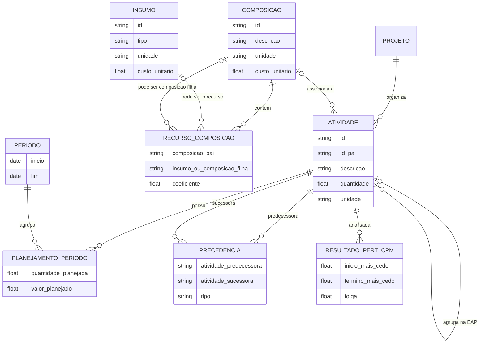
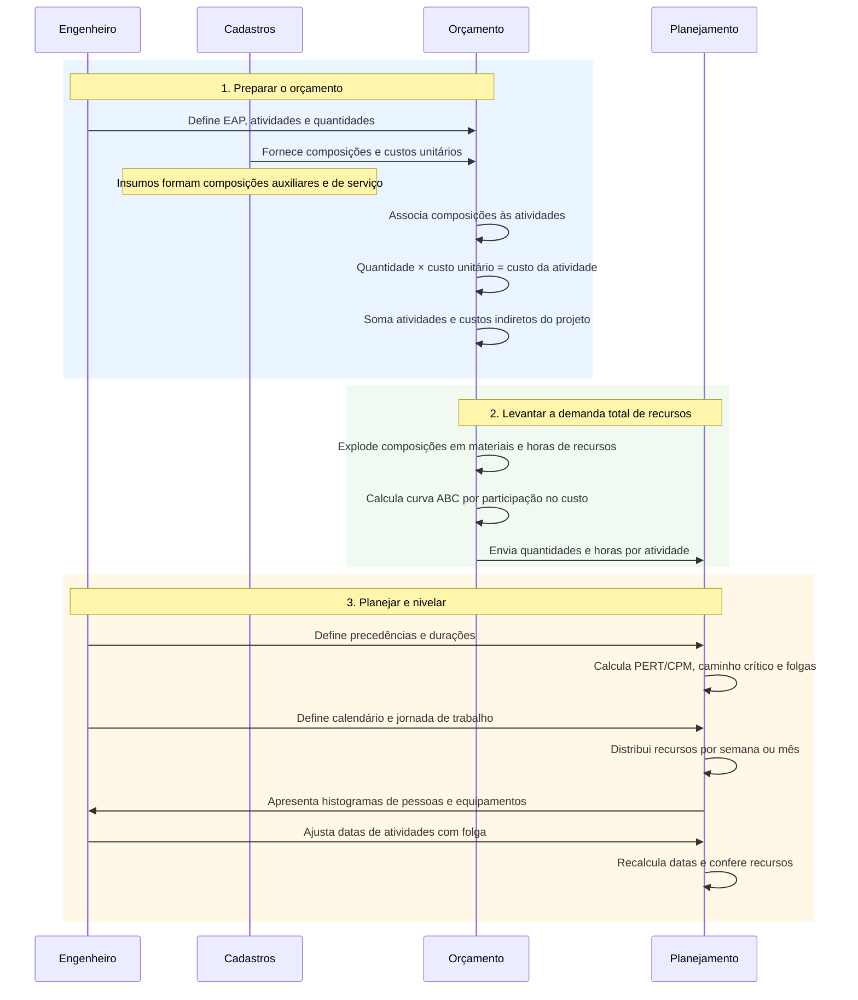
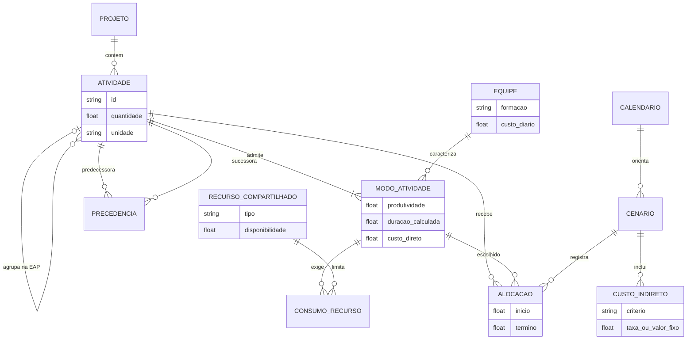
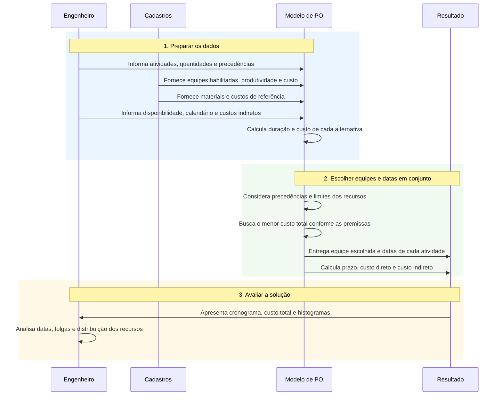

# Pesquisa operacional aplicada ao planejamento de obras

Projeto acadêmico com modelos sintéticos de EAP, composições de custos e planejamento de atividades. O modelo piloto explora alternativas de cronograma e custos com recursos limitados.

## A ideia em uma leitura

No orçamento convencional, as quantidades de serviços e as composições determinam o custo; o cronograma e a distribuição dos recursos são desenvolvidos a partir das durações e precedências. Neste trabalho, investigamos uma decisão integrada: **qual equipe habilitada executar em cada atividade e quando**, considerando que sua produtividade altera a duração e que o prazo afeta os custos indiretos do projeto.

Termos úteis: **EAP** é a decomposição hierárquica do trabalho; **composição de custo unitário (CPU)** reúne os recursos necessários por unidade de serviço; **PERT/CPM** analisa a rede de precedências, datas e folgas; e **PO** é pesquisa operacional. Uma relação pai–filho na EAP não é, por si só, uma precedência entre atividades.

## Como as informações do orçamento se relacionam

O diagrama representa o significado das entidades da base, não um esquema físico completo. Um recurso de composição é a linha que liga uma composição a um insumo **ou** a uma composição filha. A mesma composição pode ser usada em várias atividades ou composições.



Na extração descrita em [RULES.md](RULES.md), `MTAREFA` contém as atividades; `MCMP`, as composições; `MRECCMP`, suas linhas de recurso; e `MISM`, os insumos. `MTRFPLAN`/`MTRFPDO` e `MPERIODO` relacionam atividades e períodos. A extração não traz predecessoras explícitas: `PRECEDENCIA` e `RESULTADO_PERT_CPM` representam informações a levantar ou calcular, não tabelas confirmadas dessa extração.

## Fluxo convencional de orçamento e planejamento

Leia o diagrama **de cima para baixo**. Cada coluna representa uma parte do processo; as setas mostram as informações que passam entre elas. Os blocos numerados indicam a ordem principal de trabalho.



A explosão fornece as quantidades e horas totais; a curva ABC classifica os insumos por participação no custo. A sequência e as durações são definidas com apoio da experiência, de projetos anteriores e da bibliografia. A EAP organiza o escopo e não define, por si só, a sequência. O dimensionamento depende da jornada e utilização; ao deslocar atividades, é necessário conferir novamente as precedências e folgas.

Conforme o critério da empresa, alimentação e EPI podem compor os custos horários dos recursos diretos. Administração, mobilização e desmobilização são exemplos de custos que podem ser tratados separadamente como indiretos do projeto, sem dupla contagem.

## Proposta do trabalho: equipes, prazo e custo integrados

Cada atividade de serviço tem uma quantidade e alternativas de equipe habilitadas. Cada alternativa, ou **modo**, associa produtividade, formação, consumo de recursos e custo. A duração é obtida por `quantidade / produtividade`, com unidades compatíveis; por exemplo, 100 m³ a 20 m³/dia resultam em 5 dias úteis. O custo direto pode combinar custo diário de equipe e equipamento durante a execução com materiais e outros custos diretos pertinentes.

Nesta proposta, os custos de apoio antes incorporados ao custo horário do direto são tratados como indiretos, de acordo com as premissas escolhidas, sem duplicação. Custos indiretos dependentes do prazo aumentam ou diminuem com a duração do projeto; mobilização ou outros itens fixos entram uma única vez. A classificação de cada item deve ser documentada.

### Entidades propostas



`MODO_ATIVIDADE` representa a combinação habilitada de atividade e equipe: a produtividade e o custo podem depender da atividade. `ALOCACAO` registra a escolha em um cenário; conceitualmente, cada atividade executável recebe um modo por cenário. O catálogo de insumos e CPUs continua útil para fundamentar materiais e custos das alternativas, desde que as parcelas usadas no modelo sejam conciliadas.

### Fluxo de decisão

O diagrama segue a mesma leitura, de cima para baixo. O engenheiro prepara os dados; o modelo compara as alternativas e entrega uma solução para análise.



Ao mudar a equipe, mudam produtividade, duração e custo direto. A duração influencia o cronograma e o prazo do projeto; o prazo, por sua vez, influencia os custos indiretos dependentes do tempo. O custo total reúne custos diretos, indiretos e itens fixos, cada parcela contabilizada uma vez.

O modelo considera precedências e disponibilidade de recursos ao escolher equipes e inícios. O caminho crítico lógico deve ser interpretado junto às restrições de recursos; o PERT/CPM isolado não garante um cronograma executável. Histogramas ajudam a avaliar a distribuição das equipes, mas limitar recursos não significa necessariamente minimizar oscilações: para isso seria preciso um objetivo ou restrições adicionais.

**Situação do piloto:** a implementação atual já otimiza modos e inícios e inclui um indireto por dia de projeto, mobilização fixa e uma parcela de apoio por pessoa-dia. Essa última parcela ainda existe no piloto; a separação de custos desejada acima precisa ser validada e, se adotada, implementada e conciliada. O piloto usa dados sintéticos, duração determinística e pools unitários; não otimiza explicitamente o nivelamento de histogramas nem usa calendários civis. Veja o [modelo matemático](outputs/otimizacao_piloto/modelo_matematico.md) e o [guia do piloto](outputs/otimizacao_piloto/LEIA-ME.md).

As sugestões bibliográficas fornecidas para fundamentar o trabalho estão em [referências bibliográficas](referencias/referencias_fornecidas.txt). O arquivo preserva as indicações e ressalvas recebidas; ele não contém os artigos e os dados bibliográficos precisam ser conferidos antes de sua citação.

## Organização

- `scripts/`: geradores e rotinas de transformação das bases.
- `dados_anonimizados/`: versões separadas das bases anonimizadas da obra, mantidas localmente.
- `dados_simulados/`: bases sintéticas e exemplos acadêmicos independentes.
- `dados_simulados/eap_academica_sintetica/`: exemplo acadêmico resumido, CPUs e seu gerador.
- `dados_simulados/eap_academica_sintetica_escala_exemplo/`: exemplo acadêmico em escala ampliada.
- `outputs/otimizacao_piloto/`: modelo piloto, resultados e instruções de execução.
- `trabalho_final/`: artigo e roteiro do seminário.
- `referencias/`: indicações bibliográficas fornecidas para o trabalho.
- `RULES.md`: premissas, relacionamento das tabelas e instruções de reprodução.
- `APRESENTACAO.sty`: estilo LaTeX utilizado no trabalho.

O workspace também pode conter bases anonimizadas e resultados de análises de uma obra. Eles permanecem locais e estão no `.gitignore`, assim como a base sintética derivada da obra e o script de anonimização com caminhos locais. Os exemplos acadêmicos independentes continuam disponíveis para versionamento.

## Reprodução

### Gurobi no Windows

O Gurobi para Python pode ser instalado em um ambiente virtual local:

```powershell
python -m venv .venv
.\.venv\Scripts\python.exe -m pip install gurobipy
$env:GRB_LICENSE_FILE = (Resolve-Path .\gurobi.lic).Path
.\.venv\Scripts\python.exe -c "import gurobipy; print(gurobipy.gurobi.version())"
```

Defina `GRB_LICENSE_FILE` em cada terminal que for executar o Gurobi, se a licença não for descoberta automaticamente. A licença é pessoal, permanece fora do Git e pode exigir conexão com o servidor de licenças. O piloto agora possui implementação nativa em Gurobi, além da implementação anterior em `scipy.optimize.milp`:

```powershell
.\.venv\Scripts\python.exe outputs/otimizacao_piloto/resolver_gurobi.py
```

O resultado usa dados acadêmicos sintéticos e não é um orçamento real. Veja opções e limitações no [guia do piloto](outputs/otimizacao_piloto/LEIA-ME.md).

Execute os comandos a partir da raiz do projeto. Os geradores de EAP exigem uma pasta de saída que ainda não exista:

```powershell
python scripts/criar_eap_academica_sintetica.py --output eap_nova
python scripts/criar_eap_academica_escala.py --output eap_escala_nova
```

Para o piloto, consulte [as instruções específicas](outputs/otimizacao_piloto/LEIA-ME.md), incluindo as dependências e as premissas do modelo. Os dados de entrada para esse piloto estão em `dados_simulados/eap_academica_sintetica_escala_exemplo/`.

Antes de publicar, revise o conteúdo que será incluído no repositório, inclusive artigo, documentação, planilhas e histórico. A exclusão por `.gitignore` não garante anonimização nem remove arquivos já adicionados ao Git.
